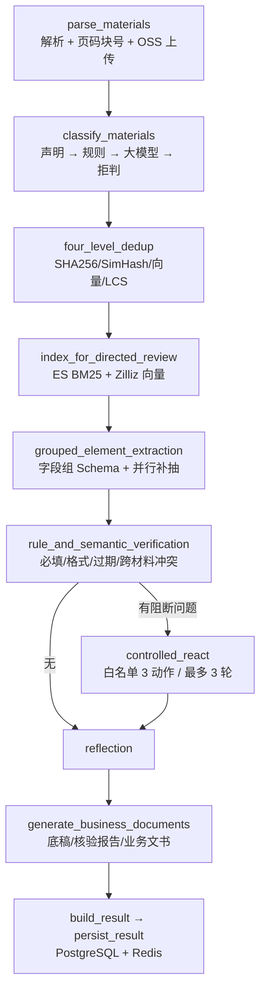

# 面试应答手册（智能受理 Agent）

> 用法：面试前 30 分钟看这一份。每条说法都能当场打开代码或跑命令验证。
> 原则：**实测过的才说数字，没实测的说机制**。

---

## 1. 一句话与两分钟版本

**一句话：**
> 针对售后申诉、供应商资质备案这类多格式业务材料的受理场景，我做了一个受控的受理 Agent：
> 固定流水线跑确定性步骤，只有异常材料才进 ReAct 工具循环，结论收敛为自动受理、补充材料、
> 人工复核三态，并且每个字段都能溯源到原文的页码和块号。

**两分钟展开顺序**（照着讲，别跳）：
1. 痛点：材料格式杂（Word/PDF/扫描件）、多份之间信息冲突、人工核验量大。
2. 架构选择：为什么不是"全交给 Agent 自由决策"——受理是强合规场景，要可解释、可审计。
3. 流水线十步（下面第 2 节的图）。
4. 三个有技术含量的点：四级去重、字段组并行抽取 + 反幻觉、双路检索融合。
5. 效果怎么量：分类评测 + 抽取评测 + 运行统计三套脚本，数字都是跑出来的。
6. 边界：哪些没做（微调）、哪些没测（没凭据的部分）。

---

## 2. 架构



代码入口：`app/intake_graph.py:235`（建图）、`app/intake_api.py:21`（HTTP 接口）。

---

## 3. 简历每条职责 → 代码 → 追问 → 答法

### 3.1 「固定流水线 + 受控 ReAct + Reflection」

- **在哪**：`app/intake_graph.py:235`；分流条件 `app/intake_graph.py:102`；
  白名单与轮次 `app/intake_tools.py:12`；Reflection 定结论 `app/intake_graph.py:124`
- **追问：为什么不直接让大模型自主规划？**
  > 受理结论要进审计。确定性步骤交给模型会带来两个不可接受的结果：同一份材料两次跑出不同字段，
  > 以及出错时无法定位是哪一步。所以我把流程固定下来，只把"查历史工单/查供应商档案/定位原文"
  > 这三个只读动作开放给 ReAct。
- **追问：怎么防止模型乱调工具？**
  > 三层。第一，动作白名单，白名单外直接阻断并转人工；第二，最多三轮；第三，也是最重要的——
  > **参数不由模型生成**。`_constrained_arguments`（`app/intake_tools.py:291`）会丢掉模型给出的
  > 主键类参数，只使用当前流程已经确认的 `case_no`、供应商名称。模型只能决定"查什么动作"，
  > 不能决定"查谁"。
- **追问：ReAct 失败怎么办？**
  > 任何一次工具调用抛异常就停止自动调用，`failed_tools` 非空时 Reflection 强制转人工复核。
  > 不会静默降级成"当没发生过"。

### 3.2 「多格式解析 + 保留页码及原文引用」

- **在哪**：`app/material_parser.py:19`（分发）、`:83`（docx 走 XML）、`:114`（PDF）、`:132`（OCR）
- **追问：Word 怎么定页码？**
  > Word 的分页是排版结果，不是文档结构，所以我不伪造物理页。做法是读 `document.xml` 时识别
  > `w:br type="page"` 和 `lastRenderedPageBreak`，按显式分页符切逻辑页。这个取舍我会主动说明——
  > 没有分页符的长文档，页码只能退化成逻辑页号。
- **追问：扫描件怎么办？**
  > 用 PyMuPDF 把没有文本层的页渲染成 2 倍图，交给 OCR。OCR 后端是可切换的
  > （`app/ocr_client.py`）：默认优先百炼多模态 `qwen-vl-ocr`，离线环境可以设成
  > `tesseract`。选云端是因为发票、营业执照这类版式传统 OCR 识别率差，而且我本机装不了
  > torch，PaddleOCR 走不通。

### 3.3 「SHA256、SimHash、向量相似度、最长公共子序列四级去重」

- **在哪**：`app/material_dedup.py:17`
- **追问：为什么要四层？一层向量不就够了？**
  > 各挡一类重复。SHA256 挡完全相同的文件，成本几乎为零；但扫描件 OCR 出来会差几个字，
  > 字节级就废了，所以 SimHash 挡局部改动；措辞改写 SimHash 也挡不住，交给向量；
  > 最后 LCS 做精核，因为向量相似高但实际内容不同的情况在业务材料里很常见。
- **追问：性能怎么处理？**
  > 两个地方。一是 LCS 是 O(n·m)，只对前三层判定为候选相似（阈值 0.65）的材料对才跑，
  > 并且文本截断到 800 字（`material_dedup.py:106`）；二是材料两两组合本身是 O(n²)，
  > 所以接口层限制单次最多 30 份材料。
- **追问：阈值怎么定的？**
  > 0.90 / 0.92 / 0.88 是经验起点，跑评测集调过。这块我承认样本量小，真实业务上要重新标定。

### 3.4 「字段组 Schema + 并行抽取 + 结构化 JSON」

- **在哪**：Schema `app/intake_scenes.py:43`；并行 `app/intake_domain.py:275`、`:290`；
  反幻觉 `app/intake_domain.py:342`
- **追问：并行是在并行什么？**
  > 并行的是**大模型调用**，不是正则。规则抽取先跑一遍，把仍然缺失的字段按字段组分组，
  > 每个字段组一次调用，线程池并发（默认 4）。正则本身是 CPU 密集且有 GIL，并行没意义。
- **追问：为什么不一次把所有字段丢给模型？**
  > 两个原因。一次问十几个字段，模型容易把值填到相邻字段上，也就是字段混淆；而且长材料下
  > 后面的字段容易被忽略，就是漏提取。按组拆开后每次上下文里只有本组 Schema，准确率明显更稳，
  > 组间并行又把延迟拉回来了。
- **追问：幻觉怎么防？**
  > 模型返回的每个值，我会做**逐字校验**——它必须能在指定原文块里找到，否则直接丢弃
  > （`intake_domain.py:335`）。同时要求它返回 `file_name/page_no/block_no`，三元组对不上也丢。
  > 这条比在 prompt 里写十遍"不要编造"有效。
- **追问：10 类场景怎么扩？**
  > 数据驱动注册表。新增一类业务只加一条 `SceneDefinition`（关键词、字段组、必填项），
  > 分类、抽取、校验、文书生成四条链路自动生效，不改流程代码。

### 3.5 「规则校验 + 语义核验 + MCP + 原文定位」

- **在哪**：规则 `app/intake_domain.py:121`；跨材料一致性 `:304`；语义核验 `:331`；
  MCP `scripts/intake_mcp_server.py`；检索 `app/es_client.py` + `app/intake_integrations.py:286`
- **追问：Elasticsearch 和向量库为什么两个都要？**
  > 因为要定位的东西分两类。订单号、运单号、统一社会信用代码、条款编号——这些必须**字面命中**，
  > 纯向量召回最容易"语义相近但号码不对"，这是 BM25 的主场；反过来客户描述故障现象措辞五花八门，
  > 关键词会漏，交给稠密向量。两路结果我用 RRF 融合，**只按名次算，不比原始分数**——
  > BM25 分数无上界，余弦在 0 到 1，跨引擎比分数没有意义（`_rrf_merge`，k=60）。
- **追问：中文分词怎么解决？**
  > ES 侧优先 `ik_max_word` 建索引、`ik_smart` 查询。代码里做了插件缺失的自动降级：建索引时
  > 如果 analyzer 报错就退回标准分析器，并把实际生效的分词器上报到 `/intake/health`。
  > 我目前还没部署 ES 实例，这块是代码就绪、待实测。
- **追问：MCP 具体做了什么？**
  > 把工单查询、供应商档案、原文定位三个能力用 FastMCP 暴露成工具，支持 stdio 和 Streamable HTTP
  > 两种传输。接外部系统靠配 `INTAKE_ARCHIVE_API_BASE_URL`，没配的时候用内置脱敏样例，
  > 但**每次返回都带 `backend=remote` 或 `local_sample`**，避免演示时被误认为是真实查询。

### 3.6 「量化成果」—— 这一节最重要

**能报的数字（本机实测）：**

| 数字 | 怎么来的 | 复现命令 |
| --- | --- | --- |
| 覆盖 10 类受理业务类型 | 场景注册表 | `GET /api/info` |
| 分类 Accuracy 80.00%、Macro-F1 0.8457 | 30 条真实措辞标注集，纯规则路径 | `python scripts/eval_classification.py` |
| 规则直判覆盖率 83.33%、直判准确率 96.00% | 同上 | 同上 |
| 要素抽取 61/61 命中 | 10 份自造样例的人工标注 | `python scripts/eval_elements.py` |

**必须主动承认边界的数字：**

> 简历上写的 97.56%、98.05% 是当时业务侧统计口径，我这边仓库里的评测集是自造样例，
> 样本量小，不能直接引用。我能现场跑给你看的是分类和抽取这两套评测的机制和当前实测值。

**完全不能报的：** 微调相关的一切（见第 5 节）、人工介入率降低 50%、可用性 99.9%。

---

## 4. 高频通用追问

**Q：LangGraph 相比自己写 if-else 的好处？**
> 主要是状态管理和可视化调试。节点函数签名统一是 `state -> partial state`，加节点、加分支
> 不用改调用方；`graph_steps` 天然就是执行轨迹，直接进结果和前端展示。
> 我没用 checkpointer，因为断点续跑在这个场景收益不大——受理是分钟级任务。

**Q：为什么不用 LangChain 的 Agent Executor？**
> 因为控制不住。我要的是"白名单 + 轮次上限 + 参数由流程注入"，Executor 的自主性反而是负担。
> 所以 ReAct 循环是自己写的（`run_controlled_react`），只复用了 LangChain 的 `StructuredTool`
> 做工具封装。

**Q：怎么保证字段可追溯？**
> 解析阶段就把 `material_id / file_name / page_no / block_no` 固化进 `PageBlock`，
> 抽取时每个字段挂 `EvidenceRef` 列表，生成文书时把来源拼在值后面。整条链路只传引用不传文本，
> 所以最后能回答"这个值是从哪一页哪一段读出来的"。

**Q：并发和性能？**
> 单请求内是字段组并行（默认 4 路）。整体是 FastAPI 异步接口，但重活（解析、向量、ES）
> 是同步阻塞的，生产要上队列。这一点我项目②里做了——RabbitMQ 异步导入 + Redis 任务状态，
> 两个项目可以对照着讲。

**Q：这个项目最大的不足是什么？**（这题一定会问）
> 三点，我按严重程度排：
> 一、分类只到 80%。关键词规则天花板很低，边界场景靠拒判兜住，但覆盖率会掉。
>    真正要提升需要标注数据和微调，我本机跑不动训练。
> 二、评测样本太小。30 条分类语料、10 条抽取样例，指标波动大，不能当业务结论。
> 三、没有真实线上流量验证，可用性、人工介入率这类运营指标我给不出来。

---

## 5. 微调（LoRA）这块怎么答

**不要主动提。** 被问到就照下面说，不要绕：

> 微调这块我没有实际做。原因是训练环境和数据我这边不具备——本机没有可用的 GPU 环境，
> torch 在这台 Windows 上装不起来。我能做的是把分类的评测体系搭起来（标注集、Accuracy、
> Macro-F1、混淆对、直判门槛的操作点权衡），如果要上微调，这套评测就是基线和验收标准。
> 简历上那三个数字是当时的业务统计口径，不是我自己训出来的，我不打算假装做过。

**如果继续追问"那你觉得要微调该怎么做"** —— 这个能答，因为机制你懂：
> 先固定评测集，不然改了不知道好没好。数据上按场景分层采样，重点补我评测里跑出来的那两个
> 混淆对——工单升级和投诉举报、异常件处理和售后申诉。基座选 7B 级别，LoRA rank 8 到 16 起步，
> 先只训分类这一个任务，不要顺手把抽取也一起训。每轮跑评测集看 Macro-F1 和覆盖率两条曲线，
> 特别要看覆盖率——微调很容易变得"什么都敢判"。

---

## 6. 现场演示脚本（30 秒）

```powershell
cd D:\faceexam\intelligent-ticket-assistant
.\.venv\Scripts\python.exe -m pytest -q          # 33 个测试
.\.venv\Scripts\python.exe scripts\eval_classification.py   # 分类指标当场出
.\scripts\run_intake.ps1                          # 起服务
```

浏览器打开 `http://127.0.0.1:8000/demo/`，左侧粘贴任意一份 `samples/` 里的材料，
点"执行智能受理"，右侧会出十步流水线、每个字段的原文页码块号、核验问题和三份文书。

**没有网络也能跑**——这句话很有说服力：所有云端依赖都有本地降级，
`/intake/health` 会如实告诉你哪一项是降级的。

---

## 7. 一句话风险清单

| 别说 | 说 |
| --- | --- |
| "我做了 SFT + LoRA 微调" | "微调我没做，做的是分类评测体系和基线" |
| "准确率 98.67%" | "我这边实测分类 80%，Macro-F1 0.85，样本 30 条" |
| "线上跑了 ES 集群" | "ES 检索层代码写完了，含 ik 分词降级，实例还没部署" |
| "人工介入率降了 50%" | "人工介入率可以从 `intake_case_runs` 表统计，脚本是 `intake_stats.py`" |
| "支撑了高并发" | "单请求内字段组并行；整体是同步阻塞，生产要上队列" |
